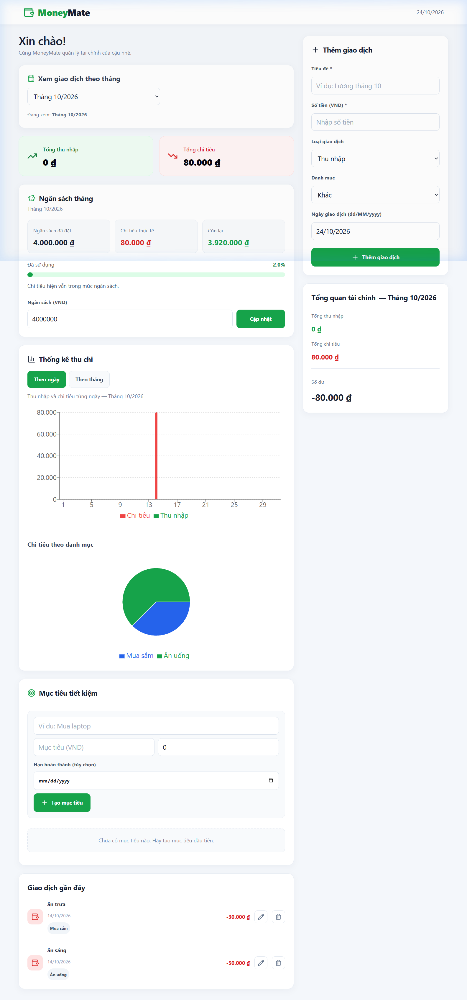
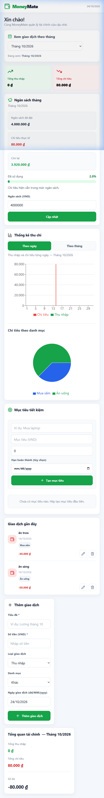

# MoneyMate — Personal Finance Management Web Application

MoneyMate is a full-stack personal finance web application built with **ASP.NET Core Web API (.NET 10)**, **Entity Framework Core**, **SQL Server**, and **React 19 + TypeScript + Vite**.

It is designed to help individuals effortlessly track income and expenses, monitor monthly spending budgets with real-time utilization warnings, visualize cash flow trends, and set financial savings goals.

---

## Table of Contents

- [Key Features](#key-features)
- [Technology Stack](#technology-stack)
- [Architecture & Project Structure](#architecture--project-structure)
- [Database Schema](#database-schema)
- [Screenshots](#screenshots)
- [Prerequisites](#prerequisites)
- [Getting Started](#getting-started)
  - [1. Clone Repository](#1-clone-repository)
  - [2. Configure Database Connection](#2-configure-database-connection)
  - [3. Apply EF Core Migrations](#3-apply-ef-core-migrations)
  - [4. Run Backend API](#4-run-backend-api)
  - [5. Run Frontend Web App](#5-run-frontend-web-app)
- [API Endpoints Overview](#api-endpoints-overview)
- [Future Improvements](#future-improvements)
- [Author & Contact](#author--contact)

---

## Key Features

- **Transaction Management (CRUD):**
  - Add, edit, and delete transactions with title, amount, type (`Income` or `Expense`), predefined categories, and date.
  - Client and server-side validation ensuring valid amounts (> 0), non-empty titles, and proper dates.
- **Monthly Filtering & Net Balance:**
  - Dynamic monthly selector filtering transactions by month or viewing all historical records.
  - Instant financial overview calculation: Total Income, Total Expense, and Net Monthly Cash Flow.
- **Monthly Budgeting with Smart Progress Tracking:**
  - Set a monthly spending limit for any specific month.
  - Automatically calculates total actual expenses in that month, remaining budget, and percentage used.
  - Dynamic visual alert states:
    - **Safe** (< 80% usage): Green progress indicator.
    - **Warning** (80% – 99% usage): Amber indicator alerting close proximity to limit.
    - **Over Budget** (>= 100% usage): Red alert banner and negative remaining balance.
- **Visual Analytics & Charting:**
  - Interactive daily bar chart comparing daily income vs. daily expense.
  - Monthly aggregation mode for year-round comparison.
  - Category breakdown pie chart displaying expense distribution.
- **Savings Goals Tracker:**
  - Create and track custom savings targets (e.g., emergency fund, laptop, travel).
  - Displays target amount, saved amount, completion percentage, remaining funds needed, and target dates.
- **Responsive & Accessible UI:**
  - Clean, modern finance dashboard with curated green/red semantic indicators.
  - Fully responsive layout adapting seamlessly from wide desktop monitors to mobile screens.

---

## Technology Stack

### Backend
- **Platform:** .NET 10 (C#)
- **Framework:** ASP.NET Core Web API
- **ORM:** Entity Framework Core 10 (`Microsoft.EntityFrameworkCore.SqlServer` 10.0.12)
- **Database:** Microsoft SQL Server / SQL Server Express
- **API Specification:** ASP.NET Core OpenAPI (`Microsoft.AspNetCore.OpenApi` 10.0.12)

### Frontend
- **Framework:** React 19
- **Language:** TypeScript
- **Build Tool:** Vite 8
- **Data Visualization:** Recharts
- **Icons:** Lucide React
- **Styling:** Custom Vanilla CSS Design System (flexbox, CSS grid, CSS custom properties, responsive media queries)

---

## Architecture & Project Structure

The project maintains a clear separation between the backend REST API service and the modern Single Page Application (SPA) frontend:

- **Backend Pattern:** Controllers directly coordinate data access through EF Core `MoneyMateDbContext` using asynchronous LINQ queries. Validation is performed both at the HTTP request layer and model configuration level.
- **Frontend Pattern:** A centralized dashboard container (`App.tsx`) orchestrates state management, transaction workflows, and monthly budget calculations, delegating chart visualizations and savings goals to modular child components (`FinanceChart.tsx` and `SavingsGoals.tsx`).

```
MoneyMate/
├── docs/
│   └── screenshots/              # Application screenshots
│       ├── desktop-dashboard.png
│       └── mobile-dashboard.png
├── MoneyMate.Api/                # ASP.NET Core Web API project
│   ├── Controllers/              # RESTful API controllers
│   │   ├── TransactionsController.cs
│   │   ├── BudgetsController.cs
│   │   ├── SavingsGoalsController.cs
│   │   └── MoneyMateController.cs
│   ├── Data/                     # EF Core DbContext and Fluent API mappings
│   │   └── MoneyMateDbContext.cs
│   ├── Migrations/               # EF Core database migrations
│   │   ├── 20261024102301_InitialCreate.cs
│   │   └── MoneyMateDbContextModelSnapshot.cs
│   ├── Models/                   # Domain entities and request contracts
│   │   ├── Transaction.cs
│   │   ├── MonthlyBudget.cs
│   │   └── SavingsGoal.cs
│   ├── appsettings.json          # Configuration & connection strings
│   ├── Program.cs                # Middleware pipeline, DI, CORS, OpenAPI
│   └── MoneyMate.Api.csproj
├── moneymate-web/                # React + TypeScript client project
│   ├── src/
│   │   ├── components/           # Presentation components
│   │   │   ├── FinanceChart.tsx  # Daily/Monthly bar charts & category pie chart
│   │   │   └── SavingsGoals.tsx  # Savings goals tracker component
│   │   ├── App.tsx               # Main dashboard controller and state container
│   │   ├── App.css               # Dashboard layout, forms, panels, responsive media queries
│   │   ├── index.css             # Root baseline CSS rules
│   │   └── main.tsx              # React entry point
│   ├── package.json
│   └── vite.config.ts
└── README.md
```

---

## Database Schema

Entity Framework Core maps the domain models to three primary relational tables in SQL Server:

### 1. `Transactions`
| Column | Type | Constraints | Description |
| :--- | :--- | :--- | :--- |
| `Id` | `int` | Primary Key, Identity | Unique transaction identifier |
| `Title` | `nvarchar(200)` | NOT NULL | Transaction title / description |
| `Amount` | `decimal(18,2)` | NOT NULL | Amount in VND |
| `Type` | `nvarchar(20)` | NOT NULL | Either `Income` or `Expense` |
| `Category` | `nvarchar(50)` | NOT NULL, Default: `'Khác'` | Category classification |
| `TransactionDate` | `datetime2` | NOT NULL | Transaction execution date |

### 2. `MonthlyBudgets`
| Column | Type | Constraints | Description |
| :--- | :--- | :--- | :--- |
| `Id` | `int` | Primary Key, Identity | Unique budget identifier |
| `BudgetMonth` | `date` | NOT NULL, UNIQUE Index | Month of budget (first day, e.g. `2026-10-01`) |
| `LimitAmount` | `decimal(18,2)` | NOT NULL | Spending threshold limit for the month |
| `CreatedAt` | `datetime2` | NOT NULL, Default: `SYSDATETIME()` | Record creation timestamp |

### 3. `SavingsGoals`
| Column | Type | Constraints | Description |
| :--- | :--- | :--- | :--- |
| `Id` | `int` | Primary Key, Identity | Unique savings goal identifier |
| `Name` | `nvarchar(200)` | NOT NULL | Name of goal (e.g., "Emergency Fund") |
| `TargetAmount` | `decimal(18,2)` | NOT NULL | Target amount to save |
| `SavedAmount` | `decimal(18,2)` | NOT NULL | Currently accumulated amount |
| `TargetDate` | `date` | NULLABLE | Optional target completion deadline |
| `CreatedAt` | `datetime2` | NOT NULL, Default: `SYSDATETIME()` | Record creation timestamp |

---

## Screenshots

### Desktop Dashboard Overview


### Mobile Responsive View


---

## Prerequisites

Before running the application, ensure the following tools are installed on your system:

1. **[.NET 10 SDK](https://dotnet.microsoft.com/download)** (Verify via `dotnet --version`)
2. **[Node.js](https://nodejs.org/)** (v18.0 or newer) and **npm**
3. **[Microsoft SQL Server](https://www.microsoft.com/en-us/sql-server/sql-server-downloads)** (SQL Server Express, Developer, or LocalDB)
4. **EF Core CLI Global Tool:**
   ```bash
   dotnet tool install --global dotnet-ef
   ```
   *(If already installed, verify with `dotnet ef --version`)*

---

## Getting Started

### 1. Clone Repository

```bash
# Replace <your-github-username> with your actual GitHub username before publishing
git clone https://github.com/<your-github-username>/MoneyMate.git
cd MoneyMate
```

### 2. Configure Database Connection

Open `MoneyMate.Api/appsettings.json` to review the default template configuration:

```json
{
  "ConnectionStrings": {
    "DefaultConnection": "Server=YOUR_SERVER;Database=MoneyMate;Trusted_Connection=True;TrustServerCertificate=True;"
  }
}
```

> **Configuration Guide:**
> - **Replace `YOUR_SERVER`**: `YOUR_SERVER` is a placeholder. You must replace it with your actual SQL Server instance name (e.g., `localhost\\SQLEXPRESS`, `localhost`, `(localdb)\\mssqllocaldb`, or `.`).
> - **Database Name (`MoneyMate`)**: `MoneyMate` is the default sample database name. Ensure your SQL Server instance is running and has permission to create/manage this database, or specify your preferred database name prior to running migrations.
> - **SQL Server Authentication**: If you are using SQL Server Authentication instead of Windows Authentication (`Trusted_Connection=True`), adjust the connection string to include your credentials:
>   ```
>   Server=YOUR_SERVER;Database=MoneyMate;User Id=YOUR_USERNAME;Password=YOUR_PASSWORD;TrustServerCertificate=True;
>   ```
> - **Local Development Overrides (`appsettings.Development.json`)**:
>   - The author's personal `appsettings.Development.json` is excluded via `.gitignore` and is not committed to GitHub to protect local environments.
>   - You can create your own `MoneyMate.Api/appsettings.Development.json` locally if you want to override the connection string or logging settings without altering tracked files in Git.


### 3. Apply EF Core Migrations

Navigate to the `MoneyMate.Api` directory and apply the initial migration. This command connects to the database defined in your connection string and creates all tables, indexes, and constraints:

```bash
cd MoneyMate.Api
dotnet ef database update
```

When successful, the CLI outputs `Done.`. Your database schema is now ready.

> **Important:**
> - `dotnet ef database update` is intended for fresh or clean database instances.
> - If you target an existing database that already contains tables created manually without an `__EFMigrationsHistory` table, EF Core will attempt to execute `CREATE TABLE` and fail with a table collision error.
> - The application **does not automatically migrate on startup**, keeping schema lifecycle management predictable, safe, and controlled via CLI.

### 4. Run Backend API

From the `MoneyMate.Api` folder, start the Web API service:

```bash
dotnet run --launch-profile http
```

The API service will start listening:
- **API Base URL:** `http://localhost:5141`
- **OpenAPI Schema Document:** `http://localhost:5141/openapi/v1.json`
- **Health Check Endpoint:** `http://localhost:5141/api/MoneyMate/hello`

### 5. Run Frontend Web App

Open a **separate terminal window**, navigate to `moneymate-web`, install dependencies, and start the Vite dev server:

```bash
cd moneymate-web
npm install
npm run dev
```

The frontend will be available at:
- **Web Application:** `http://localhost:5173`

Open your browser and navigate to `http://localhost:5173` to start using MoneyMate.

---

## API Endpoints Overview

| Method | Endpoint | Description | Sample Payload / Parameters |
| :--- | :--- | :--- | :--- |
| **GET** | `/api/MoneyMate/hello` | API health check & connectivity status | — |
| **GET** | `/api/transactions` | Retrieve all transactions (sorted date descending) | — |
| **GET** | `/api/transactions/{id}` | Retrieve a single transaction by ID | `id`: integer |
| **POST** | `/api/transactions` | Create a new transaction | `{"title":"Lunch","amount":50000,"type":"Expense","category":"Ăn uống","transactionDate":"2026-10-14T00:00:00"}` |
| **PUT** | `/api/transactions/{id}` | Update an existing transaction | `{"title":"Monthly Salary","amount":15000000,"type":"Income","category":"Lương","transactionDate":"2026-10-14T00:00:00"}` |
| **DELETE** | `/api/transactions/{id}` | Delete a transaction | `id`: integer |
| **GET** | `/api/budgets/{year}/{month}` | Get monthly budget summary, expense sum & status | Example: `/api/budgets/2026/10` |
| **PUT** | `/api/budgets/{year}/{month}` | Set or update monthly budget spending limit | `{"limitAmount": 5000000}` |
| **GET** | `/api/savingsgoals` | Retrieve all savings goals | — |
| **POST** | `/api/savingsgoals` | Create a new savings goal | `{"name":"Emergency Fund","targetAmount":10000000,"savedAmount":2000000,"targetDate":"2026-12-31T00:00:00"}` |
| **PUT** | `/api/savingsgoals/{id}` | Update an existing savings goal | `{"name":"Laptop","targetAmount":25000000,"savedAmount":10000000,"targetDate":null}` |
| **DELETE** | `/api/savingsgoals/{id}` | Delete a savings goal | `id`: integer |

---

## Future Improvements

- [ ] **Repository & Service Layer Pattern:** Introduce business service and repository abstractions to facilitate unit testing.
- [ ] **Server-side Pagination & Filtering:** Add query pagination (`page`, `pageSize`) and server-side date range filtering.
- [ ] **Interactive API Explorer (Swagger UI / Scalar):** Integrate visual interactive API testing UI at `/swagger` or `/scalar/v1`.
- [ ] **User Authentication & Multi-Tenancy:** Implement JWT-based authentication (ASP.NET Core Identity) for individual user accounts.
- [ ] **Automated Testing Suite:** Add unit tests for business logic and calculations (xUnit, Moq, Vitest).
- [ ] **Data Export:** Export monthly financial reports to CSV and PDF formats.

---

## Author & Contact

- **Developer:** [Your Full Name]
- **Target Role:** .NET Fresher / Intern Developer
- **Email:** [your.email@example.com]
- **LinkedIn:** [https://linkedin.com/in/your-profile]
